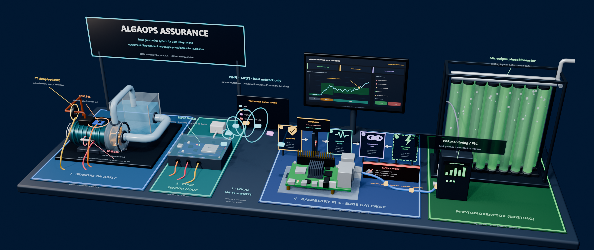
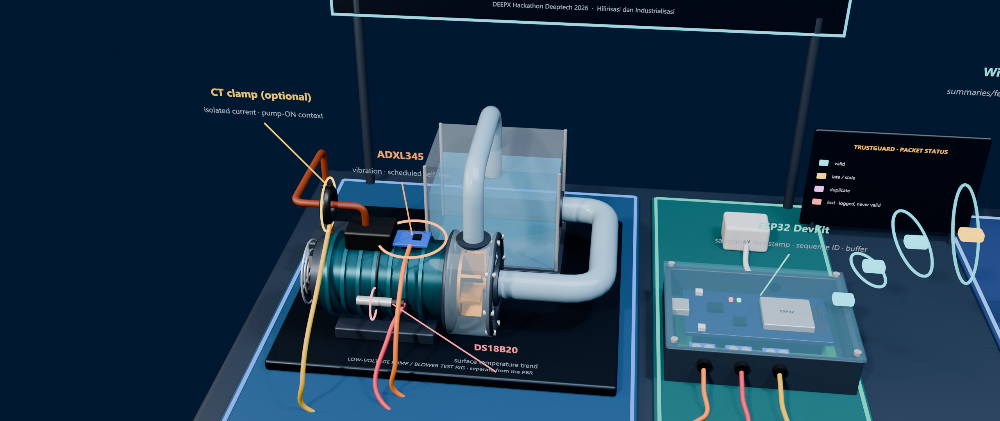
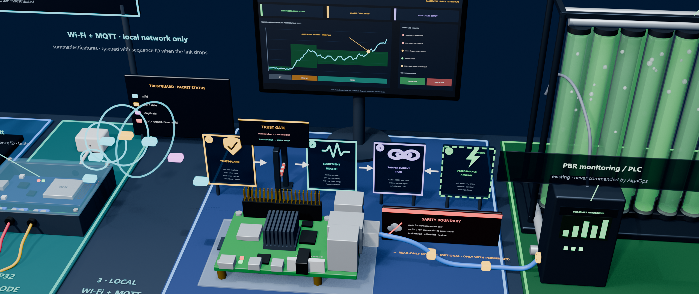

# AlgaOps: Edge Trust-Gated Photobioreactor Auxiliary Assurance

<div align="center">



**Sistem Edge Trust-Gated untuk Integritas Data dan Diagnosis Peralatan Bantu Fotobioreaktor Mikroalga**

[](algaops-assurance/)
[](algaops-assurance/)
[](algaops-assurance/docs/test-plan.md)
[](algaops-assurance/LICENSE)

*Program Pendanaan Hackathon DeepTech 2026 — Universitas Padjadjaran & Kementerian Pendidikan Tinggi, Sains, dan Teknologi*  
*Mitra Riset: PT. Algatek Karbon Nusantara*

</div>

---

## 📌 Executive Summary

Dalam budidaya mikroalga menggunakan **Photobioreactor (PBR)**, kegagalan peralatan bantu—terutama pompa sirkulasi kultur dan blower aerasi—merupakan penyebab utama pengendapan biomassa, thermal shock, dan kematian kultur (*culture crash*) yang dapat merugikan industri hingga puluhan juta rupiah.

Sistem monitoring IoT konvensional seringkali gagal di lingkungan PBR yang lembap dan berinterferensi listrik tinggi karena **tidak mampu membedakan anomali sensor (data palsu/rusak) dengan kerusakan mekanis riil**.

**AlgaOps Assurance** menghadirkan paradigma **Trust-Gated Diagnostics**:
1. **TrustGuard (Feature A):** Melakukan verifikasi integritas data sensor secara real-time pada edge (deteksi packet loss, duplikasi, non-monotonic timestamps, sensor macet/*stuck*, dan nilai di luar batas fisis).
2. **Trust-Gated Equipment Health (Feature B):** Mengevaluasi anomali peralatan mekanik berbasis deviasi statistik (Z-score) terhadap *baseline* operasi normal.
3. **The Trust Gate Invariant:** Jika integritas data diragukan (`is_trusted == false`), evaluasi kesehatan mesin **wajib diblokir (suppressed)** dan sistem mengeluarkan peringatan `CHECK_SENSOR`, sehingga mencegah alarm palsu kerusakan mesin (*false equipment alarms*).

---

## 🎨 System Visualization & 3D Models

<div align="center">
<table>
  <tr>
    <td align="center"><b>Auxiliary Pump Rig & Sensor Pod</b></td>
    <td align="center"><b>Edge Assurance Gateway Unit</b></td>
  </tr>
  <tr>
    <td></td>
    <td></td>
  </tr>
  <tr>
    <td><i>Monitoring sensor getaran (RMS) dan sensor suhu permukaan pada dudukan pompa PBR</i></td>
    <td><i>Unit Edge Gateway offline-first pemroses algoritma Trust-Gated Assurance</i></td>
  </tr>
</table>
</div>

---

## 📂 Repository Layout

```text
AlgaOps/
├── README.md                      # Dokumentasi utama repositori
├── AlgaOps_Proposal.md            # Naskah lengkap proposal Hackathon DeepTech 2026
├── AlgaOps_Assurance_3D.blend     # Model 3D rig PBR, sensor pod, dan gateway (Blender)
├── AlgaOps_Overview.png           # Render arsitektur lengkap sistem
├── AlgaOps_PumpRig_CloseUp.png    # Render detail rig pompa dan sensor
├── AlgaOps_Gateway_CloseUp.png    # Render unit edge gateway
└── algaops-assurance/             # IMPLEMENTASI INTI (C11 Core Project)
    ├── CMakeLists.txt             # Build system CMake (C11, strict warnings)
    ├── README.md                  # Dokumentasi teknis engineering C project
    ├── LICENSE                    # Lisensi Open Source MIT
    ├── include/                   # Header API publik C11 (portable, zero-dependency)
    │   ├── algaops_types.h        # Definisi struktur data, flags, dan konfigurasi default
    │   ├── trustguard.h           # API Feature A: TrustGuard
    │   └── equipment_health.h     # API Feature B: Equipment Health
    ├── src/                       # Source code implementasi C11
    │   ├── main.c                 # Driver CLI (evaluasi streaming CSV & export)
    │   ├── csv_reader.c           # Parser CSV dengan validasi sintaks ketat
    │   ├── trustguard.c           # Algoritma validasi integritas sensor
    │   └── equipment_health.c     # Algoritma Z-score & Trust-Gated suppression
    ├── tests/                     # 24 automated unit & integration tests
    │   ├── test_trustguard.c      # 10 unit tests Feature A
    │   ├── test_equipment_health.c# 8 unit tests Feature B
    │   └── test_integration.c     # 6 end-to-end integration tests
    ├── data/                      # Dataset sintetis deterministik untuk demonstrasi
    │   ├── baseline_normal.csv    # 30 sampel operasi normal untuk baseline
    │   ├── scenario_normal.csv    # Skenario verifikasi kondisi normal
    │   ├── scenario_missing_packet.csv # Skenario kehilangan paket data (network loss)
    │   ├── scenario_stuck_sensor.csv   # Skenario sensor membeku/macet
    │   └── scenario_equipment_anomaly.csv # Skenario anomali mekanik & termal
    └── docs/                      # Dokumen spesifikasi teknis
        ├── architecture.md        # Arsitektur detail & diagram Mermaid data flow
        └── test-plan.md           # Rencana pengujian & matriks verifikasi
```

---

## ⚡ Quick Start: Building & Running Core

Modul komputasi inti ditulis dalam **C11 standar** murni tanpa dependensi eksternal, sehingga dapat langsung dikompilasi pada Linux, macOS, maupun Windows:

```bash
# Masuk ke direktori proyek C
cd algaops-assurance

# Buat direktori build dan kompilasi dengan CMake
mkdir build && cd build
cmake ..
cmake --build .

# Jalankan seluruh 24 unit & integration test
ctest --output-on-failure
```

### Menjalankan CLI Evaluasi Skenario

```bash
# Menjalankan evaluasi anomali peralatan terhadap baseline normal
./algaops --baseline ../data/baseline_normal.csv \
          --input ../data/scenario_equipment_anomaly.csv \
          --output ../results.csv
```

Dokumentasi lengkap mengenai API C, konfigurasi threshold, dan detail teknis arsitektur dapat dilihat pada direktori [**`algaops-assurance/`**](algaops-assurance/).

---

## 👥 Tim Pengusul (Universitas Andalas)

- **Ahmad Saidi** (Ketua Tim Pelaksana)
- **Rayhan Habibi** (Software & Embedded Systems Engineering)
- **Yoan Purbolingga** (Dosen Pendamping)
- **Filjisalim C. Ramadhana**
- **Jenius Anugrah Ridwan**

---

## 📄 Lisensi

Kode sumber komputasi inti didistribusikan di bawah lisensi open-source [MIT License](algaops-assurance/LICENSE).
