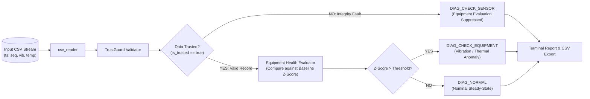

# AlgaOps Assurance Core

**Edge Trust-Gated Data Integrity and Equipment Diagnostics for Microalgae Photobioreactors (PBR)**

[](https://en.wikipedia.org/wiki/C11_(C_standard_revision))
[](https://cmake.org/)
[](LICENSE)
[](#disclaimer--limitations)

---

## 1. Project Overview & Motivation

In microalgae photobioreactors (PBRs), auxiliary support machinery—such as culture circulation pumps and sparging blowers—must operate continuously. Unplanned equipment failures lead rapidly to culture sedimentation, thermal overheating, stagnation, and catastrophic biological crash.

However, deploying naive edge predictive maintenance systems in humid, outdoor, or electronically noisy PBR environments frequently creates a major operational hazard: **false equipment alarms triggered by sensor faults**. Loose wiring, ADC lockups, RF packet loss, and sensor drift can easily mimic bearing failure or motor overheating.

**AlgaOps Assurance** solves this problem through **Trust-Gated Diagnostics**:
- **TrustGuard (Feature A)** continuously validates incoming physical measurements for temporal coherence, packet sequence integrity, physical bounds, and frozen/stuck signals.
- **Trust-Gated Equipment Health (Feature B)** only evaluates baseline deviation when data integrity is fully established.
- If data integrity is compromised, equipment-health evaluation is **strictly suppressed**, reporting `CHECK_SENSOR` instead of attributing anomalies to equipment wear.
- The system produces non-invasive **inspection warnings** for human operators, rather than unverified automatic PBR control actions.

---

## 2. Scope: Exactly Two Core Features

This repository implements the standalone, portable C11 computational core:

| Feature | Name | Responsibility |
| :--- | :--- | :--- |
| **Feature A** | **TrustGuard** | Validates measurement records (missing packets, duplicate/out-of-order sequence IDs, non-monotonic timestamps, out-of-range values, stuck sensors, non-finite values) and outputs a trust score (0–100), integrity bitmask flags, and trusted/untrusted decision. |
| **Feature B** | **Trust-Gated Equipment Health** | Computes baseline statistics ($\mu$, $\sigma$) from normal operation data, calculates Z-score deviations for vibration and temperature, enforces zero-variance numerical safety, and blocks equipment diagnosis when sensor data is untrusted. |

*Note: Live ESP32/ADXL345 drivers, MQTT telemetry, cloud dashboards, and automated pump actuation are intentionally out of scope for this core software PoC.*

---

## 3. Architecture & Trust-Gated Data Flow



### Primary Diagnostic Outcomes

- `NORMAL`: Data is trusted and equipment vibration/temperature stay within configured baseline limits.
- `CHECK_SENSOR`: Data integrity is questionable (packet loss, stuck sensor, bad timestamp, etc.). Equipment-health evaluation is blocked to avoid false alarms.
- `CHECK_EQUIPMENT`: Data is trusted, but one or more indicators deviate significantly from baseline ($Z > 3.0$).

---

## 4. Repository Structure

```text
algaops-assurance/
├── CMakeLists.txt                # CMake build configuration (C11, strict warnings)
├── README.md                     # Project overview and user guide
├── LICENSE                       # MIT Open Source License
├── .gitignore                    # Build artifacts and temp file exclusions
├── include/                      # Public API headers (portable, no dependencies)
│   ├── algaops_types.h           # Shared structs, constants, and default configs
│   ├── trustguard.h              # TrustGuard public interface & state types
│   └── equipment_health.h        # Equipment Health public interface & state types
├── src/                          # Core implementation
│   ├── main.c                    # CLI entry point
│   ├── csv_reader.c              # Safe CSV parser with syntax validation
│   ├── csv_reader.h              # Internal CSV reader header
│   ├── trustguard.c              # Feature A: TrustGuard validator implementation
│   └── equipment_health.c        # Feature B: Equipment Health evaluator implementation
├── tests/                        # Comprehensive automated test suites (24 tests)
│   ├── test_trustguard.c         # Unit tests for Feature A (10 tests)
│   ├── test_equipment_health.c   # Unit tests for Feature B (8 tests)
│   └── test_integration.c        # End-to-end integration tests (6 tests)
├── data/                         # Synthetic demonstration and baseline datasets
│   ├── baseline_normal.csv       # 30 clean samples for baseline statistics
│   ├── scenario_normal.csv       # All-normal verification scenario
│   ├── scenario_missing_packet.csv # Injected sequence gaps (network loss)
│   ├── scenario_stuck_sensor.csv # Frozen vibration signal (sensor lockup)
│   └── scenario_equipment_anomaly.csv # Vibration and thermal degradation
└── docs/                         # Technical documentation
    ├── architecture.md           # Architectural specification & state machines
    └── test-plan.md              # Test plan and verification matrix
```

---

## 5. Prerequisites & Build Instructions

### Prerequisites
- **C Compiler**: Any ISO C11 compliant compiler (`gcc`, `clang`, or `MSVC`).
- **CMake**: Version 3.16 or higher.
- **Build tool**: `make`, `ninja`, or MSYS2 MinGW Makefiles.

### Build Steps

#### Linux / macOS
```bash
git clone https://github.com/your-org/algaops-assurance.git
cd algaops-assurance
mkdir build && cd build
cmake ..
cmake --build .
```

#### Windows (PowerShell with MSYS2 MinGW64)
```powershell
$env:PATH = "C:\msys64\mingw64\bin;C:\msys64\usr\bin;" + $env:PATH
cd algaops-assurance
New-Item -ItemType Directory -Force -Path build
cd build
cmake -G "MinGW Makefiles" ..
cmake --build .
```

The build produces the main CLI executable `algaops` (`algaops.exe` on Windows) and three test executables in the `build/` directory.

---

## 6. CLI Usage & Demonstration

### Command-Line Syntax
```bash
algaops --baseline <baseline_csv> --input <input_csv> [--output <results_csv>]
```

| Parameter | Required | Description |
| :--- | :---: | :--- |
| `--baseline <file>` | Yes | Path to representative normal-operation baseline CSV (minimum 10 valid records). |
| `--input <file>` | Yes | Path to input sensor stream CSV to evaluate. |
| `--output <file>` | Optional | Path to write machine-readable diagnostic evaluation CSV. |
| `--help` | Optional | Displays usage instructions and parameter documentation. |
| `--version` | Optional | Displays software version information. |

---

## 7. CSV Input Schema & Measurement Units

The CSV reader accepts comma-delimited files with an optional header and comment lines starting with `#`:

```csv
timestamp_ms,sequence_id,vibration_rms_g,temperature_c
1000,1,0.420,28.1
2000,2,0.415,28.2
3000,3,0.425,28.0
```

| Field Name | Type | Unit | Description |
| :--- | :---: | :---: | :--- |
| `timestamp_ms` | `uint64` | milliseconds ($\text{ms}$) | Monotonically advancing acquisition timestamp. |
| `sequence_id` | `uint32` | counter | Monotonically increasing packet counter. |
| `vibration_rms_g`| `float` | $\text{g}$ ($1\,\text{g} \approx 9.80665\,\text{m/s}^2$) | Root Mean Square acceleration over measurement window. |
| `temperature_c` | `float` | $^\circ\text{C}$ | Equipment surface temperature. |

---

## 8. Preliminary Threshold Configuration

All parameters are declared with default values in [`include/algaops_types.h`](include/algaops_types.h) and can be configured programmatically:

```c
TrustGuardConfig tg_cfg = trustguard_default_config();
tg_cfg.vib_min_g              = 0.0;    // Minimum plausible vibration (g)
tg_cfg.vib_max_g              = 50.0;   // Maximum plausible vibration (g)
tg_cfg.temp_min_c             = -10.0;  // Minimum plausible temperature (°C)
tg_cfg.temp_max_c             = 120.0;  // Maximum plausible temperature (°C)
tg_cfg.stuck_window_size      = 5;      // Rolling window sample depth
tg_cfg.stuck_vib_threshold_g  = 0.001;  // Min variation over window (g) before stuck flag
tg_cfg.stuck_temp_threshold_c = 0.01;   // Min variation over window (°C) before stuck flag
tg_cfg.trust_score_threshold  = 60;     // Min score (0-100) for trusted record

EquipmentHealthConfig eh_cfg = equipment_health_default_config();
eh_cfg.z_score_threshold      = 3.0;    // Standard deviation anomaly threshold
eh_cfg.min_baseline_samples   = 10;     // Minimum clean baseline records required
eh_cfg.min_std_dev            = 1e-6;   // Variance floor preventing division-by-zero
```

> **Engineering Notice:** These thresholds are preliminary engineering defaults for demonstration purposes. In production, thresholds must be calibrated against the specific pump/blower make and mounting conditions.

---

## 9. Example Outputs Across Scenarios

### Scenario 1: Normal Operation (`data/scenario_normal.csv`)
```bash
algaops --baseline data/baseline_normal.csv --input data/scenario_normal.csv
```
```text
  ts=31000     seq=31     vib=0.4210g  temp=28.20°C
  TrustScore: 100  Trusted: YES    Flags: INTEGRITY_OK
  Integrity:  OK
  Diagnostic: NORMAL            Reason: NORMAL: vib z=0.51, temp z=0.49 (both <= threshold 3.00)
...
Summary:
  Records processed : 10
  NORMAL            : 10
  CHECK_SENSOR      : 0
  CHECK_EQUIPMENT   : 0
```

### Scenario 2: Stuck Sensor (`data/scenario_stuck_sensor.csv`)
Demonstrating Trust-Gating suppression of equipment diagnostics when sensor freezes:
```bash
algaops --baseline data/baseline_normal.csv --input data/scenario_stuck_sensor.csv
```
```text
  ts=35000     seq=35     vib=0.4200g  temp=28.00°C
  TrustScore: 80   Trusted: NO     Flags: VIB_STUCK
  Integrity:  vibration stuck: range 0.000000 g < threshold 0.001000 g over 5 samples
  Diagnostic: CHECK_SENSOR      Reason: CHECK_SENSOR: data integrity blocked evaluation — vibration stuck...
...
Summary:
  Records processed : 10
  NORMAL            : 8
  CHECK_SENSOR      : 2
  CHECK_EQUIPMENT   : 0
```

### Scenario 3: Equipment Anomaly (`data/scenario_equipment_anomaly.csv`)
Demonstrating detection of genuine mechanical anomaly when sensor data is trusted:
```bash
algaops --baseline data/baseline_normal.csv --input data/scenario_equipment_anomaly.csv
```
```text
  ts=35000     seq=35     vib=1.8500g  temp=28.20°C
  TrustScore: 100  Trusted: YES    Flags: INTEGRITY_OK
  Integrity:  OK
  Diagnostic: CHECK_EQUIPMENT   Reason: CHECK_EQUIPMENT: vibration z=588.21 > threshold 3.00 (1.8500 g vs baseline 0.4198±0.0024 g)
  Z-scores:   vib=588.21  temp=0.49
...
Summary:
  Records processed : 10
  NORMAL            : 4
  CHECK_SENSOR      : 0
  CHECK_EQUIPMENT   : 6
```

---

## 10. Automated Testing

The project includes 24 automated unit and integration tests.

### Running with CTest
```bash
cd build
ctest --output-on-failure
```

### Running Test Suites Individually
```bash
./build/test_trustguard          # 10 unit tests for Feature A
./build/test_equipment_health    # 8 unit tests for Feature B
./build/test_integration         # 6 end-to-end pipeline tests
```

---

## 11. Disclaimer & Limitations

1. **Proof of Concept:** This codebase is an initial software core proof-of-concept developed for demonstration and algorithmic validation. It has **not** been validated in long-duration industrial trials on a live microalgae production facility.
2. **Synthetic Datasets:** All datasets provided in `data/` are synthetically and deterministically generated. They do **not** represent field measurements from PT Algatek or any industrial photobioreactor.
3. **Advisory System:** AlgaOps Assurance generates operational inspection warnings for maintenance personnel. It is **not** a safety-critical automatic shutdown controller and must not be used as the sole protection mechanism for critical machinery.
4. **Future Extensions:** Live physical sensor acquisition (ADXL345 I2C/SPI, DS18B20 1-Wire), ESP32 FreeRTOS tasks, MQTT edge gateways, and tamper-evident audit logging are planned architectural extensions and are not included in this core computational release.

---

## 12. License

This project is licensed under the MIT License — see the [LICENSE](LICENSE) file for details.
