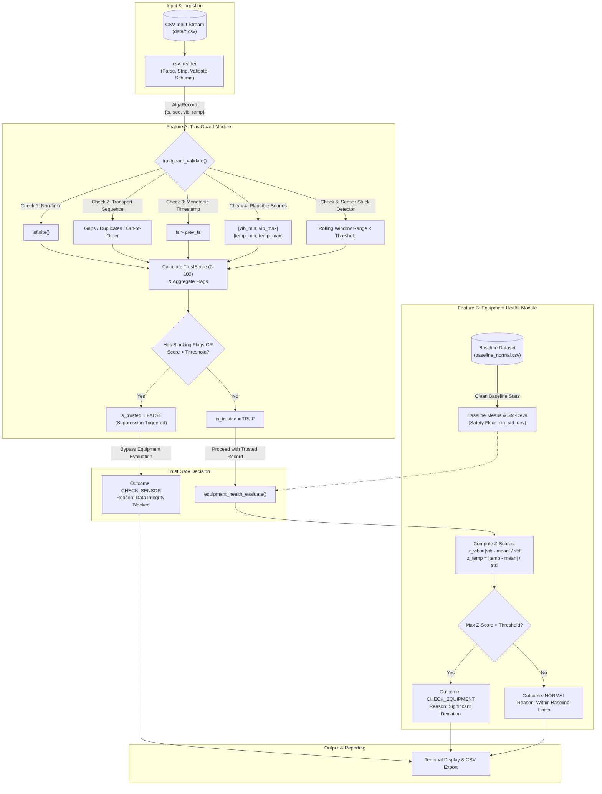

# AlgaOps Assurance — Architecture & Design

> **Document Version:** 1.0.0  
> **Target Standard:** ISO/IEC 9899:2011 (C11)  
> **System Class:** Edge-oriented Data Integrity & Predictive Maintenance Core

---

## 1. Executive Summary & Philosophy

In microalgae photobioreactors (PBRs), continuous culture health depends critically on auxiliary support machinery—specifically circulation pumps and aeration blowers. Equipment failures (e.g., impeller imbalance, bearing wear, shaft misalignment) can cause culture stagnation, thermal shock, and catastrophic crash within hours.

However, naive edge monitoring systems often trigger false alarms or incorrect automated shutdowns when **sensor integrity fails** (e.g., stuck sensors, missing packets, signal jitter, loose wiring, non-finite values).

**AlgaOps Assurance** resolves this via **Trust-Gated Diagnostics**:
1. Every sensor record is rigorously scrutinized by **TrustGuard** before equipment health is evaluated.
2. If data fails integrity checks, equipment health evaluation is **strictly suppressed**, emitting `CHECK_SENSOR` rather than attributing anomalous values to equipment degradation.
3. Only when sensor data is verified **TRUSTED** does the **Equipment Health** module evaluate baseline deviation to emit `NORMAL` or `CHECK_EQUIPMENT`.
4. Outputs are non-invasive **inspection warnings** for operators, avoiding unverified automatic process control.

---

## 2. Architectural Pipeline & Data Flow

The following Mermaid flowchart illustrates the sequential execution and gating mechanism implemented in `algaops`:

---

## 3. Module Breakdown & Responsibilities

The software is strictly decoupled into independent, reusable C11 modules:

### 3.1 Data Types & Contract (`include/algaops_types.h`)
- Defines physical measurement structures (`AlgaRecord`), configuration schemas (`TrustGuardConfig`, `EquipmentHealthConfig`), output structures (`TrustResult`, `HealthResult`), and diagnostic outcome enumerations.
- No dynamic memory allocation requirements; 100% portable across desktop C11 and 32-bit embedded MCUs (e.g., ESP32, STM32).
- All configurable parameters are documented with initial engineering defaults.

### 3.2 Ingestion Module (`src/csv_reader.c`, `src/csv_reader.h`)
- Thread-safe, line-oriented parser designed to reject corrupted entries gracefully.
- Features:
  - Handles `#` comment lines and empty rows.
  - Validates numeric conversions with `strtoull`, `strtoul`, and `strtod` with full end-pointer verification.
  - Checks for non-finite values (`NAN`, `INFINITY`).
  - Reports informative syntax error messages detailing filename and line number.

### 3.3 Feature A: TrustGuard (`src/trustguard.c`, `include/trustguard.h`)
- Maintains rolling state (`TrustGuardState`) across consecutive measurement records.
- **Sequence Verification:**
  - `INTEGRITY_DUPLICATE_SEQ`: Sequence matches previous packet.
  - `INTEGRITY_OUT_OF_ORDER_SEQ`: Sequence is strictly less than previous packet.
  - `INTEGRITY_MISSING_PACKET`: Packet sequence jumps ahead by $> 1$. (Note: Informational flag for arriving packet; does not block evaluation unless paired with other violations).
- **Temporal Verification:**
  - `INTEGRITY_BAD_TIMESTAMP`: Timestamp does not monotonically advance ($t \le t_{prev}$).
- **Range Verification:**
  - `INTEGRITY_VIB_OUT_OF_RANGE`: Vibration outside $[0.0, 50.0]\,\text{g}$.
  - `INTEGRITY_TEMP_OUT_OF_RANGE`: Temperature outside $[-10.0, 120.0]\,^\circ\text{C}$.
- **Stuck-Sensor Heuristic:**
  - Circular rolling window of size $N$ (default: 5).
  - Computes $\text{Range} = \max(x) - \min(x)$.
  - Triggers `INTEGRITY_VIB_STUCK` if $\text{Range}_{vib} < \text{threshold}$ (default: $0.001\,\text{g}$).
  - Triggers `INTEGRITY_TEMP_STUCK` if $\text{Range}_{temp} < \text{threshold}$ (default: $0.01\,^\circ\text{C}$).
- **Trust Score & Blocking Logic:**
  - Informational score in range $[0, 100]$.
  - Blocking flags (`DUPLICATE`, `OUT_OF_ORDER`, `BAD_TIMESTAMP`, `NON_FINITE`, `MALFORMED`, `OUT_OF_RANGE`, `STUCK`) unequivocally enforce `is_trusted = false`.

### 3.4 Feature B: Equipment Health (`src/equipment_health.c`, `include/equipment_health.h`)
- **Baseline Establishment:**
  - Ingests normal-operation dataset (`baseline_normal.csv`).
  - Runs each baseline record through TrustGuard; discards untrusted samples.
  - Rejects baselines with fewer than `min_baseline_samples` (default: 10).
  - Computes sample mean ($\mu$) and sample standard deviation ($\sigma$).
  - **Zero-Variance Safety:** Clamps $\sigma \ge \text{min\_std\_dev}$ ($10^{-6}$) to prevent division by zero or NaN generation on ultra-stable machinery.
- **Trust-Gated Evaluation:**
  - If `!trust_result->is_trusted`, immediately returns `DIAG_CHECK_SENSOR`, copying the TrustGuard explanation.
  - If trusted, computes standard scores:
    $$z_{vib} = \frac{|x_{vib} - \mu_{vib}|}{\max(\sigma_{vib}, \sigma_{floor})}, \quad z_{temp} = \frac{|x_{temp} - \mu_{temp}|}{\max(\sigma_{temp}, \sigma_{floor})}$$
  - Compares against `z_score_threshold` (default: $3.0$).
  - Emits:
    - `DIAG_NORMAL` if $z_{vib} \le 3.0$ and $z_{temp} \le 3.0$.
    - `DIAG_CHECK_EQUIPMENT` if $z_{vib} > 3.0$ or $z_{temp} > 3.0$.

### 3.5 Command Line Interface (`src/main.c`)
- CLI driver coordinating baseline loading, input streaming, terminal reporting, and optional CSV export.
- Standard arguments: `--baseline <file>`, `--input <file>`, `[--output <file>]`, `--help`, `--version`.

---

## 4. Engineering & Safety Considerations

1. **No Unbounded Memory:** Fixed-size structures, zero heap churn during processing loop.
2. **Defensive Formatting:** All string formatting uses explicit bounds (`%.450s` inside `snprintf`) to eliminate `-Wformat-truncation` warnings and guarantee buffer safety.
3. **Deterministic Execution:** No thread race conditions, no pseudo-random dependencies, 100% reproducible test vectors.
4. **Distinction of Scope:**
   - **Implemented:** Core C11 validation algorithms, baseline statistical evaluation, CLI, test harness.
   - **Out of Scope (Simulation Only):** Live I2C/SPI sensor drivers, ESP32 RTOS tasks, physical PBR valve control, cloud MQTT brokers.
